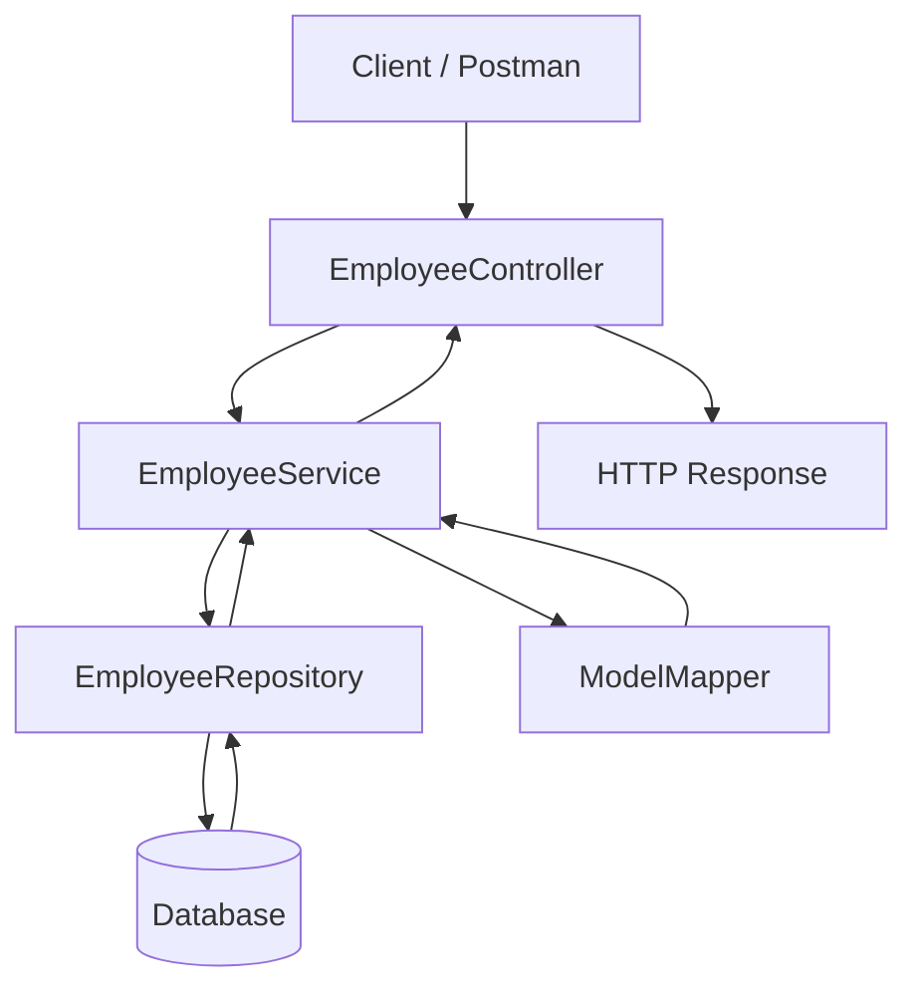

# Employee Management System

A RESTful Employee Management System built with Java and Spring Boot. The application provides APIs to create, retrieve, update, partially update, and delete employee records using a layered backend architecture.

This project demonstrates practical backend development concepts, including REST API design, DTO-based data transfer, service-layer business logic, repository-based persistence, validation, and HTTP response handling.

## Features

- **Create Employees:** Add new employee records with request validation.
- **Retrieve Employee by ID:** Fetch a specific employee and return `404 Not Found` when the employee does not exist.
- **Retrieve All Employees:** Fetch the list of employee records.
- **Update Employees:** Update employee information using the `PUT` endpoint.
- **Partial Updates:** Modify selected employee fields using the `PATCH` endpoint.
- **Delete Employees:** Delete an existing employee and handle missing records.
- **DTO Mapping:** Use ModelMapper to convert between employee DTOs and entities.
- **Layered Architecture:** Separate controllers, services, repositories, DTOs, and entities.
- **HTTP Status Handling:** Use `ResponseEntity` to return appropriate HTTP responses.
- **Request Validation:** Apply Jakarta Bean Validation using `@Valid`.

## Tech Stack

| Technology | Purpose |
|---|---|
| Java | Backend programming |
| Spring Boot | Application framework |
| Spring Web | REST API development |
| Spring Data JPA | Repository-based data access, if configured |
| Jakarta Validation | Request validation |
| ModelMapper | DTO and entity conversion |
| Maven | Dependency management and build automation |
| Relational Database | Persistent storage, according to project configuration |

## Project Architecture

The application follows a layered architecture that separates HTTP request handling from business logic and data access.



### Package Structure

```text
src/main/java/com/example/springbootwebtutorial/
├── annotations/
├── configs/
├── controllers/
│   └── EmployeeController.java
├── dto/
│   └── EmployeeDTO.java
├── entities/
│   └── EmployeeEntity.java
├── repositories/
│   └── EmployeeRepository.java
├── services/
│   └── EmployeeService.java
└── SpringbootwebtutorialApplication.java
```

- **Controllers:** Expose REST endpoints and handle HTTP requests and responses.
- **Services:** Implement employee-management operations and coordinate data access.
- **Repositories:** Provide database access for employee records.
- **DTOs:** Define the data transferred between clients and the application.
- **Entities:** Represent employee records in the persistence layer.
- **Configs:** Hold application configuration and supporting bean definitions.
- **Annotations:** Contain custom annotations, if implemented.

## REST API Endpoints

The base path for all employee endpoints is `/employees`.

| HTTP Method | Endpoint | Description | Success Response |
|---|---|---|---|
| GET | `/employees` | Retrieve all employees | `200 OK` |
| GET | `/employees/{employeeID}` | Retrieve an employee by ID | `200 OK` |
| POST | `/employees` | Create a new employee | `201 Created` |
| PUT | `/employees/{employeeId}` | Update an employee | `200 OK` |
| PATCH | `/employees/{employeeId}` | Partially update an employee | `200 OK` |
| DELETE | `/employees/{employeeId}` | Delete an employee | `200 OK` |

For requests involving an employee ID that does not exist, the controller returns `404 Not Found` where explicitly handled. Validation failures and other errors depend on the application's exception-handling configuration.

## Example API Requests

Use Postman or another HTTP client to test the endpoints.

### 1. Retrieve All Employees

```http
GET /employees
```

Returns a list of employees.

### 2. Retrieve an Employee by ID

```http
GET /employees/1
```

Returns the employee with ID `1`, or `404 Not Found` if no matching employee exists.

### 3. Create an Employee

```http
POST /employees
Content-Type: application/json
```

Example request body — replace the fields with those defined in `EmployeeDTO`:

```json
{
  "name": "Aarav Sharma"
}
```

The actual JSON fields and required values depend on the DTO definition.

### 4. Update an Employee

```http
PUT /employees/1
Content-Type: application/json
```

Send the employee data required by the application's DTO.

### 5. Partially Update an Employee

```http
PATCH /employees/1
Content-Type: application/json
```

Example request body — use a field that exists in `EmployeeEntity`:

```json
{
  "name": "Aarav Verma"
}
```

The current implementation uses reflection to update fields on the employee entity. Supported fields depend on the entity structure and should be validated before use.

### 6. Delete an Employee

```http
DELETE /employees/1
```

Deletes the employee if the record exists.

## Getting Started

### Prerequisites

- Java Development Kit compatible with the project.
- Maven or the Maven Wrapper included in the repository.
- A configured database if required by the application.

### 1. Clone the Repository

```bash
git clone https://github.com/seemaamola/employee-management-system.git
cd employee-management-system
```

### 2. Configure the Application

Check `src/main/resources/application.properties` or `application.yml` for the application's configuration.

Set the appropriate database connection details and other required properties based on the project setup.

### 3. Build the Project

If the Maven Wrapper is available:

```bash
./mvnw clean package
```

Otherwise:

```bash
mvn clean package
```

### 4. Run the Application

```bash
./mvnw spring-boot:run
```

Alternatively, use `mvn spring-boot:run` if Maven is installed.

The application runs on the configured server port. For the default Spring Boot configuration, this is typically port `8080`.

## Key Concepts Demonstrated

- Building RESTful APIs with Spring Boot.
- Using dependency injection and constructor-based initialization.
- Separating business logic into a service layer.
- Handling missing resources with `Optional` and HTTP status codes.
- Mapping DTOs to persistence entities using ModelMapper.
- Validating incoming request bodies with `@Valid`.
- Implementing CRUD operations using a repository abstraction.
- Supporting partial updates through the HTTP `PATCH` method.
- Working with Java collections, streams, and reflection.

## Potential Improvements

- Add centralized exception handling with `@ControllerAdvice`.
- Validate allowed fields and values in partial-update requests.
- Replace reflection-based updates with explicit, type-safe mapping.
- Prevent updates to nonexistent employee IDs.
- Add pagination, sorting, and filtering.
- Implement unit and integration tests.
- Add API documentation using OpenAPI/Swagger.
- Configure authentication and authorization with Spring Security.
- Add Docker support for consistent local development.

## Author

**Seema Amola**

GitHub: [@seemaamola](https://github.com/seemaamola)

Project Repository: [Spring Web Tutorial — Employee Management System](https://github.com/seemaamola/Spring-Web-Tutorial)
This project is intended for educational purposes and demonstrates backend application development using Java and Spring Boot.
